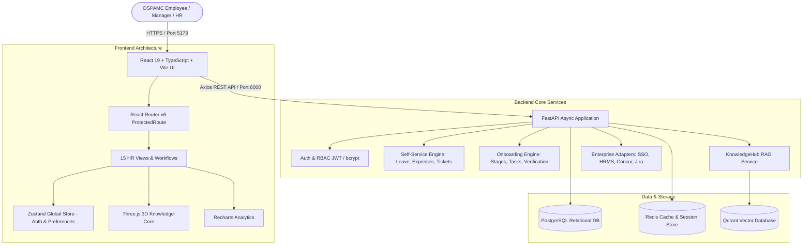

# DSP KnowledgeHub AI — Employee HR & Process Intelligence Platform

[](https://fastapi.tiangolo.com/)
[](https://react.dev/)
[](https://vitejs.dev/)
[](https://www.python.org/)
[](https://www.postgresql.org/)
[](https://qdrant.tech/)
[](https://redis.io/)
[](https://tailwindcss.com/)

An institutional-grade, conversational AI and employee process automation platform built for **DSP Asset Management Company (DSPAMC)** employees, managers, and HR administrators.

---

## 📑 Table of Contents

1. [Executive Overview & Purpose](#-executive-overview--purpose)
2. [Platform Feature Matrix](#-platform-feature-matrix)
3. [Architecture & System Design](#-architecture--system-design)
4. [Technology Stack](#-technology-stack)
5. [Repository & Codebase Structure](#-repository--codebase-structure)
6. [Getting Started & Local Development](#-getting-started--local-development)
7. [API Reference Summary](#-api-reference-summary)
8. [Enterprise Integration Adapters](#-enterprise-integration-adapters)
9. [Institutional Demo Accounts](#-institutional-demo-accounts)

---

## 🎯 Executive Overview & Purpose

**DSP KnowledgeHub AI** eliminates friction across internal employee operations by unifying HR self-service, onboarding roadmaps, IT access provisioning, SAP Concur expense reimbursements, and SEBI compliance pre-clearance into a single intelligent platform:

- **Conversational Policy RAG Assistant**: Grounded answers with verbatim citations linking directly to authoritative DSPAMC policy handbooks (Leave Policy, Mediclaim, Travel Policy, Code of Conduct).
- **Employee Self-Service (ESS)**: Real-time leave balance tracking, one-click leave applications, expense claim submissions, and IT equipment requests.
- **Onboarding Journey**: Structured new-hire roadmap (Day 1 to Day 90), buddy coordination, mandatory NISM regulatory compliance tracking, and document verification.
- **Manager & HR Console**: Unified approval center for pending leaves, expense reimbursements, and candidate onboarding oversight.
- **SEBI Compliance Shield**: Personal trading pre-clearance requests, 30-day holding window verification, and restricted list checks.

---

## 🌟 Platform Feature Matrix

```
┌────────────────────────────────────────────────────────────────────────────────────────┐
│                                APPLICATION MODULES MAP                                 │
├─────────────────────────┬────────────────────────────────┬─────────────────────────────┤
│ Module                  │ Route / Component              │ Operational Focus           │
├─────────────────────────┼────────────────────────────────┼─────────────────────────────┤
│ 1. Home Dashboard       │ `/` (EmployeeDashboard.tsx)    │ Leave summary, tasks, feeds │
│ 2. AI Assistant Copilot │ `/assistant` (KnowledgeHub.tsx)│ 3D Core + RAG with citations│
│ 3. Leave & Absence      │ `/leave` (MyLeave.tsx)         │ Balance cards, apply, cancel│
│ 4. Reimbursements       │ `/reimbursements`              │ Concur claims & summaries   │
│ 5. Service Requests     │ `/requests` (MyRequests.tsx)   │ IT hardware, IAM tickets    │
│ 6. Onboarding Portal    │ `/onboarding` (Onboarding.tsx) │ 90-day checklist & buddy    │
│ 7. HR Onboarding Admin  │ `/onboarding/hr`               │ Candidate roster & reviews  │
│ 8. Manager Approvals    │ `/approvals` (Approvals.tsx)   │ Multi-tier workflow queue   │
│ 9. Policies & Circulars │ `/policies` (ProcessViews.tsx) │ HR & travel policy dossiers │
│ 10. IT Access Workflow  │ `/it-access` (ProcessViews.tsx)│ ServiceHub, VPN, Bloomberg  │
│ 11. Compliance Hub      │ `/compliance` (ProcessViews)   │ SEBI trade pre-clearance    │
│ 12. Employee Directory  │ `/directory` (ProcessViews)    │ Departmental escalation map │
│ 13. Activity Feed       │ `/activity` (MyActivity.tsx)   │ Chronological audit log     │
│ 14. Employee Profile    │ `/profile` (Profile.tsx)       │ Personal details, emergency │
│ 15. Admin Integrations  │ `/admin` (AdminIntegrations)   │ Azure AD, SAP, Jira status  │
│ 16. Security & Login    │ `/login` (Login.tsx)           │ JWT session & MFA           │
└─────────────────────────┴────────────────────────────────┴─────────────────────────────┘
```

---

## 🏛️ Architecture & System Design



---

## 🛠️ Technology Stack

| Layer | Technologies | Purpose |
|---|---|---|
| **Frontend Framework** | React 19, TypeScript, Vite 8 | Strict type-safety, rapid rendering & modern bundle optimization |
| **Routing & Protection** | React Router v6, ProtectedRoute | Client-side routing with role-based route guards |
| **State Management** | Zustand | Global session state, notifications, and UI preferences |
| **Styling & Theme** | Tailwind CSS v4, Custom Dark Tokens | Responsive fintech dark theme with consistent design tokens |
| **Component Primitives** | Radix UI | Accessible dialogs, dropdowns, tabs, progress bars, and tooltips |
| **3D Visualization** | Three.js, React Three Fiber (`@react-three/drei`) | Dynamic 3D interactive Knowledge Core in AI Assistant |
| **Visual Charts** | Recharts, Lucide React Icons | Leave quotas, expense breakdown charts, status badges |
| **Backend Framework** | Python 3.11+, FastAPI, Uvicorn, ASGI | High-throughput asynchronous REST API |
| **Data Validation** | Pydantic v2, Pydantic-Settings | Request/response schemas and environment configuration |
| **ORM & Database** | SQLAlchemy 2.0 (Asyncio), Greenlet, asyncpg | Fully async database operations |
| **AI & RAG Engine** | LangChain, Qdrant Vector DB, Tiktoken | Document chunking, vector similarity, and verifiable citations |
| **Authentication & Security** | JWT (`python-jose`), Passlib, bcrypt | Secure authentication, salted hashing, and RBAC |
| **Observability & Logging** | Structlog, SlowAPI | Structured JSON logging and endpoint rate limiting |

---

## 📂 Repository & Codebase Structure

```
HR_DOCPROJECT/
├── backend/                              # FastAPI Python Backend
│   ├── app/
│   │   ├── api/                          # REST API Routers
│   │   │   ├── auth.py                   # Employee login, session validation, JWT tokens
│   │   │   ├── onboarding.py             # New-hire roadmap, tasks, document upload
│   │   │   ├── research.py               # Conversational RAG assistant, citations
│   │   │   └── self_service.py           # Leave ledger, expense claims, IT tickets
│   │   ├── core/                         # Core infrastructure
│   │   │   ├── config.py                 # Pydantic Settings configuration
│   │   │   ├── database.py               # Async SQLAlchemy engine & session factory
│   │   │   └── security.py               # Password hashing & JWT helpers
│   │   ├── models/                       # Database Models
│   │   │   └── user.py                   # User & role authentication model
│   │   ├── schemas/                      # Pydantic Schemas
│   │   │   ├── onboarding_schemas.py     # Onboarding task and checklist schemas
│   │   │   ├── self_service_schemas.py   # Leave, claim, and ticket schemas
│   │   │   └── schemas.py                # Base API response & auth contracts
│   │   ├── services/                     # Business Logic Services
│   │   │   ├── integration_adapters.py   # Azure AD, PeoplePulse, Concur, Jira adapters
│   │   │   ├── knowledge_service.py      # HR policy RAG engine & approved docs
│   │   │   ├── onboarding_service.py     # 90-day onboarding workflow state machine
│   │   │   └── self_service_service.py   # Leave balances, claims, approval logic
│   │   └── main.py                       # Application initialization & lifecycle
│   └── requirements.txt                  # Python dependencies
│
├── frontend/                             # React 19 + TypeScript + Vite UI
│   ├── src/
│   │   ├── components/                   # UI Components
│   │   │   ├── AppHeader.tsx             # Notification center & user identity
│   │   │   ├── AppSidebar.tsx            # Navigation drawer & conversation history
│   │   │   ├── KnowledgeCore3D.tsx       # Three.js 3D interactive Knowledge Core
│   │   │   ├── ChatMessage.tsx           # Policy chat bubbles with Markdown
│   │   │   ├── CitationCard.tsx          # Verified document citation cards
│   │   │   ├── Layout.tsx                # App frame & sidebar wrapper
│   │   │   └── ProtectedRoute.tsx        # RBAC route guard
│   │   ├── pages/                        # Views & Pages
│   │   │   ├── EmployeeDashboard.tsx     # Home self-service dashboard
│   │   │   ├── KnowledgeHub.tsx          # AI Copilot conversational assistant
│   │   │   ├── MyLeave.tsx               # Leave ledger, balances, and apply
│   │   │   ├── MyReimbursements.tsx       # Expense claims & summaries
│   │   │   ├── MyRequests.tsx            # ServiceHub IT requests
│   │   │   ├── Onboarding.tsx            # Employee 90-day onboarding roadmap
│   │   │   ├── OnboardingHR.tsx          # HR & manager onboarding portal
│   │   │   ├── Approvals.tsx             # Manager approval center
│   │   │   ├── ProcessViews.tsx          # Policies, IT access, compliance views
│   │   │   ├── Profile.tsx               # Employee dossier & emergency contacts
│   │   │   ├── MyActivity.tsx            # Chronological audit log
│   │   │   └── AdminIntegrations.tsx     # Enterprise system status
│   │   ├── services/                     # Axios API Service Layer
│   │   │   └── api.ts                    # HR API client (Auth, Self-Service, RAG, Onboarding)
│   │   ├── store/                        # Global State
│   │   │   └── useAppStore.ts            # Zustand store (Auth, Session, UI preferences)
│   │   ├── App.tsx                       # React Router configuration
│   │   ├── index.css                     # Tailwind CSS & theme tokens
│   │   └── main.tsx                      # App entry point
│   ├── package.json                      # Frontend dependencies & scripts
│   └── vite.config.ts                    # Vite build configuration
│
├── tests/                                # Test Suite
│   ├── test_knowledge_service.py         # RAG policy retrieval and citation tests
│   ├── test_self_service.py              # Leave, reimbursement, and approval tests
│   └── test_live_api.py                  # Live API integration tests
└── README.md                             # Platform documentation (this file)
```

---

## 🚀 Getting Started & Local Development

### Prerequisites
- **Node.js**: v18.0 or later (v20+ recommended)
- **Python**: v3.11 or later

### Step 1: Start the Backend (FastAPI)
```bash
# Navigate to backend
cd backend

# Activate virtual environment
# Windows:
..\backend\.venv\Scripts\activate
# macOS/Linux:
source .venv/bin/activate

# Start the FastAPI server on port 8000
python -m uvicorn app.main:app --reload --port 8000
```
- **API Swagger Docs**: [http://127.0.0.1:8000/api/docs](http://127.0.0.1:8000/api/docs)
- **Health Check**: [http://127.0.0.1:8000/api/v1/health](http://127.0.0.1:8000/api/v1/health)

### Step 2: Start the Frontend (Vite)
Open a new terminal:
```bash
# Navigate to frontend
cd frontend

# Start the Vite development server
npm run dev
```
- **Application URL**: [http://localhost:5173/](http://localhost:5173/)

---

## 🔑 Institutional Demo Accounts

| Role | Employee Code / Email | Password | Allowed Capabilities |
|---|---|---|---|
| **Senior Analyst** | `EMP-1001` / `aditi.sharma@dspamc.com` | `Password@123` | Self-service, apply leaves, submit expense claims, AI copilot |
| **Quant Strategist** | `EMP-1002` / `rohan.mehta@dspamc.com` | `Password@123` | Self-service, IT service requests, compliance pre-clearance |
| **Reporting Manager** | `EMP-1003` / `vikram.seth@dspamc.com` | `Password@123` | Approvals center, team leave decisions, onboarding review |
| **HR Administrator** | `EMP-HR-01` / `pooja.varma@dspamc.com` | `Password@123` | Candidate onboarding assignment, document audit, admin portal |
| **Chief Compliance** | `EMP-COMP-01` / `suresh.nair@dspamc.com` | `Password@123` | SEBI personal trading review, restricted securities audit |
