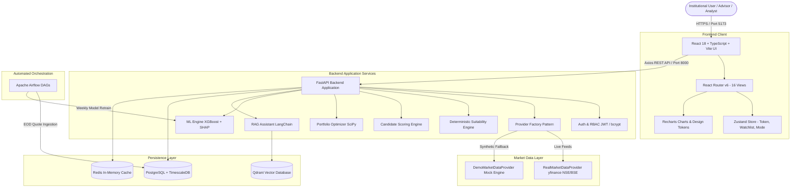

# DSP AI Investment Intelligence Platform — System Updates & Platform Scope

**Document Version**: 2.0  
**Target Market**: Indian Equity Markets (NSE / BSE)  
**Target Audience**: Institutional Asset Managers, Wealth Advisors, Relationship Managers, Portfolio Managers, Quant Analysts, Compliance Officers  
**Last Updated**: October 2026

---

## 📑 Table of Contents

1. [Executive Summary](#1-executive-summary)
2. [What Has Been Done Till Now (Chronological & Milestone Updates)](#2-what-has-been-done-till-now)
3. [Complete Platform Coverage (All 16 Modules)](#3-complete-platform-coverage-all-16-modules)
   - [3.1 Advisor & Relationship Manager (RM) Command Center](#31-advisor--relationship-manager-rm-command-center)
   - [3.2 Client Book Management & Tier Segmentation](#32-client-book-management--tier-segmentation)
   - [3.3 Client 360° Comprehensive Dossier & Rebalancing](#33-client-360-comprehensive-dossier--rebalancing)
   - [3.4 Executive Market Dashboard](#34-executive-market-dashboard)
   - [3.5 Markets Intelligence, Heatmap & India VIX](#35-markets-intelligence-heatmap--india-vix)
   - [3.6 Portfolio Analytics & Markowitz MPT Optimizer](#36-portfolio-analytics--markowitz-mpt-optimizer)
   - [3.7 Stock Screener & Universe Exploration](#37-stock-screener--universe-exploration)
   - [3.8 Stock Detail Analysis with Explainable AI (SHAP)](#38-stock-detail-analysis-with-explainable-ai-shap)
   - [3.9 Active Watchlist & Technical Signals](#39-active-watchlist--technical-signals)
   - [3.10 AI Research Assistant & Document RAG Engine](#310-ai-research-assistant--document-rag-engine)
   - [3.11 Goal-Based Investing & Wealth Glidepaths](#311-goal-based-investing--wealth-glidepaths)
   - [3.12 Risk Management & Crisis Stress Testing](#312-risk-management--crisis-stress-testing)
   - [3.13 Institutional Reporting & Tax Harvesting](#313-institutional-reporting--tax-harvesting)
   - [3.14 Model Intelligence, MLOps & Drift Monitoring](#314-model-intelligence-mlops--drift-monitoring)
   - [3.15 System Settings & Data Provider Switcher](#315-system-settings--data-provider-switcher)
   - [3.16 Security, Authentication & Role-Based Access Control](#316-security-authentication--role-based-access-control)
4. [Backend & Quantitative Engines](#4-backend--quantitative-engines)
   - [4.1 Dual-Provider Market Data Architecture](#41-dual-provider-market-data-architecture)
   - [4.2 Deterministic SEBI Suitability Engine](#42-deterministic-sebi-suitability-engine)
   - [4.3 Multi-Factor Candidate Scoring Engine](#43-multi-factor-candidate-scoring-engine)
   - [4.4 Walk-Forward Machine Learning Pipeline](#44-walk-forward-machine-learning-pipeline)
   - [4.5 Portfolio Math & Optimization Solver](#45-portfolio-math--optimization-solver)
5. [Complete Architecture & Data Flow](#5-complete-architecture--data-flow)
6. [Technology Stack](#6-technology-stack)
7. [Repository File Map](#7-repository-file-map)
8. [API Route Catalog](#8-api-route-catalog)
9. [How to Run Locally (Frontend & Backend)](#9-how-to-run-locally)
10. [Regulatory Guardrails & Compliance Standards](#10-regulatory-guardrails--compliance-standards)
11. [Current Status & Next Steps Roadmap](#11-current-status--next-steps-roadmap)

---

## 1. Executive Summary

The **DSP AI Investment Intelligence Platform** is an enterprise-grade wealth management, portfolio optimization, quantitative analysis, and decision-support system tailored for Indian capital markets (NSE & BSE).

Unlike generic retail trading tools or unconstrained generative AI wrappers, this platform operates on three non-negotiable principles:
1. **Deterministic Regulatory Compliance**: Investor risk profiling, asset allocation boundaries, and concentration caps strictly adhere to **SEBI (Investment Advisers) Regulations** via mathematical rules, preventing hallucinated advice.
2. **Transparent, Explainable AI (XAI)**: Machine learning models (XGBoost & LightGBM) are decomposed via **TreeSHAP**, giving advisors and analysts clear positive and negative factor attribution for every price prediction.
3. **Institutional Dual-Provider Architecture**: The system cleanly decouples market data providers through a centralized factory. It streams live NSE/BSE feeds via Yahoo Finance in production, with an offline synthetic fallback that maintains strict mathematical OHLC integrity for air-gapped demoing and testing.

---

## 2. What Has Been Done Till Now

Below is the chronological record of engineering milestones accomplished on the platform:

### Milestone 1: Core Architecture & Data Layer
- [x] Initialized modern monorepo layout separating `frontend/`, `backend/`, `data-pipeline/`, `infrastructure/`, and `tests/`.
- [x] Configured asynchronous FastAPI backend with Pydantic v2 data models, SQLAlchemy async ORM, and structured JSON logging (`structlog`).
- [x] Created `MarketDataProvider` abstract base class and built `RealMarketDataProvider` using `yfinance` for live NSE (`.NS`) and BSE (`.BO`) tickers.
- [x] Engineered `DemoMarketDataProvider` with zero-dependency synthetic OHLC generation ensuring strict mathematical validity ($\text{Low} \le \text{Open, Close} \le \text{High}$).
- [x] Implemented `ProviderFactory` with fail-closed production safety to prevent synthetic mock data from leaking into live advisory environments.
- [x] Standardized API response wrappers with metadata lineage (`data_status: "LIVE" | "DEMO"`, timestamp, and source provider).

### Milestone 2: Machine Learning & Quantitative Portfolio Engines
- [x] Built 26+ feature engineering pipeline in `backend/app/ml/features.py` computing momentum (RSI, MACD, Stochastics), trend (SMA, EMA crossovers), volatility (Bollinger Bands, ATR), and volume (VWAP, OBV) via `ta`.
- [x] Implemented XGBoost and LightGBM regressors with walk-forward temporal cross-validation.
- [x] Integrated TreeSHAP to compute feature importance attributions for every individual stock prediction.
- [x] Built Markowitz Mean-Variance Portfolio Optimizer (`optimizer.py`) using `scipy.optimize.minimize` supporting Maximum Sharpe, Minimum Volatility, and Target Return modes with single-stock and sector exposure caps.
- [x] Implemented historical scenario stress testing (2008 Global Financial Crisis, 2020 COVID Shock, Rate Hike cycle, Rupee devaluation) and parametric/historical Value-at-Risk (VaR 95% / 99%).

### Milestone 3: Relationship Management, Suitability & Client 360°
- [x] Created database schema and models for `Client`, `Goal`, `Portfolio`, `Position`, `Proposal`, and `AuditLog`.
- [x] Developed `SuitabilityEngine` enforcing deterministic SEBI risk profiling, asset class bounds, and concentration warnings without generative AI.
- [x] Built `CandidateScoringEngine` generating composite rankings based on Value (30%), Quality (30%), Momentum (20%), and ML Alpha (20%).
- [x] Built full Client 360° APIs with goal tracking, inflation-adjusted SIP calculators, and what-if rebalancing simulation.
- [x] Implemented Relationship Manager (RM) dashboard aggregation endpoint (`/api/v1/dashboard/summary`) tracking overdue client reviews, critical alerts, and rebalancing pipelines.

### Milestone 4: Frontend Application (16 Dedicated Views)
- [x] Built high-density, Bloomberg-grade institutional dark UI using React 18, TypeScript, Vite 8, and custom CSS design system (`index.css`).
- [x] Developed Recharts visualization suite (Area price charts, Volume bars, Asset allocation pies, Sector bars, Correlation heatmaps).
- [x] Implemented global Zustand store (`useAppStore.ts`) managing authentication tokens, active client contexts, watchlist items, and data provider states.
- [x] Built `EmployeeDashboard.tsx` (RM Command Center), `ClientBook.tsx` (Advisor CRM), and `Client360.tsx` (Client dossier and proposal generator).
- [x] Implemented `Dashboard.tsx`, `Markets.tsx`, `Portfolio.tsx`, `Explore.tsx`, `StockDetail.tsx`, and `Research.tsx`.
- [x] Added `Login.tsx` with JWT authentication and protected routing via `ProtectedRoute.tsx`.

### Milestone 5: Testing, Orchestration & Documentation
- [x] Created comprehensive test suite in `tests/test_backend.py` validating OHLC integrity, provider factory safety, MPT optimization bounds, and suitability logic.
- [x] Created `docker-compose.yml` orchestrating Frontend, Backend, PostgreSQL + TimescaleDB, Redis, and Qdrant.
- [x] Authored Apache Airflow DAGs (`data-pipeline/dags/dag_definitions.py`) for automated EOD quote ingestion and model retraining.

---

## 3. Complete Platform Coverage (All 16 Modules)

```
┌────────────────────────────────────────────────────────────────────────┐
│                      PLATFORM APPLICATION MAP                          │
├─────┬──────────────────────────┬───────────────────┬───────────────────┤
│ #   │ Module Name              │ Frontend Route    │ Target Role       │
├─────┼──────────────────────────┼───────────────────┼───────────────────┤
│ 1   │ RM Command Center        │ `/`               │ Wealth Advisor/RM │
│ 2   │ Client Book Manager      │ `/clients`        │ Wealth Advisor/RM │
│ 3   │ Client 360° Dossier      │ `/clients/:id`    │ Wealth Advisor/RM │
│ 4   │ Executive Dashboard      │ `/dashboard`      │ Executive/Analyst │
│ 5   │ Markets Intelligence     │ `/markets`        │ Trader/Analyst    │
│ 6   │ Portfolio Analytics      │ `/portfolio`      │ Portfolio Manager │
│ 7   │ Stock Screener           │ `/explore`        │ Research Analyst  │
│ 8   │ Stock Detail Deep Dive   │ `/stock/:symbol`  │ Equity Analyst    │
│ 9   │ Active Watchlist         │ `/watchlist`      │ Trader/Advisor    │
│ 10  │ AI Research Assistant    │ `/research`       │ Research Analyst  │
│ 11  │ Goal-Based Wealth        │ `/goals`          │ Financial Planner │
│ 12  │ Risk & Stress Testing    │ `/risk`           │ Risk Officer      │
│ 13  │ Reporting Center         │ `/reports`        │ Operations/RM     │
│ 14  │ Model Intelligence MLOps │ `/models`         │ Quant/ML Engineer │
│ 15  │ System Settings          │ `/settings`       │ System Admin      │
│ 16  │ Authentication & Login   │ `/login`          │ All Users         │
└─────┴──────────────────────────┴───────────────────┴───────────────────┘
```

---

### 3.1 Advisor & Relationship Manager (RM) Command Center
- **Route**: `/` (`EmployeeDashboard.tsx`)
- **Key Capabilities**:
  - **AUM Command Banner**: Instant visibility of total relationship book AUM, active client accounts, and average portfolio size.
  - **High-Risk Alert Feed**: Real-time detection of portfolio concentration (>15% in a single security or >30% in a sector), risk profile mismatches, KYC expiries, and reviews overdue (>90 days).
  - **Daily Agenda & Workflows**: Dedicated schedule tracking client meetings, pending proposal approvals, and upcoming SIP renewals.
  - **Quick Client Navigator**: Direct search and jump to any client's dossier.

### 3.2 Client Book Management & Tier Segmentation
- **Route**: `/clients` (`ClientBook.tsx`)
- **Key Capabilities**:
  - **Client Roster**: High-density table of all assigned accounts with client codes, full names, assigned AUM, and risk categorizations.
  - **Tier Segmentation**: Grouping by Retail, High Net Worth Individual (HNI), Ultra HNI, and Family Office.
  - **Multi-parameter Filtering**: Filter by risk tolerance (Conservative, Moderate, Aggressive, Very Aggressive), KYC compliance status, or alert severity.
  - **Compliance Indicators**: Visual tags flagging accounts that require annual suitability re-certification.

### 3.3 Client 360° Comprehensive Dossier & Rebalancing
- **Route**: `/clients/:id` (`Client360.tsx`)
- **Key Capabilities**:
  - **Client Identity**: Complete contact details, PAN reference, KYC tier, tax residency, and assigned investment mandate.
  - **Financial Goals & Glidepaths**: Compares accumulated corpus against target amount for multiple goals (Retirement, Higher Education, Estate Planning), calculating shortfall and required monthly SIP.
  - **Asset Allocation vs Target Policy**: Real-time breakdown of Equity, Debt, Gold, and Liquid Cash against the client's Investment Policy Statement (IPS).
  - **Active Holdings Ledger**: Detailed table showing stock symbol, company name, shares held, buy price, current market price, total value, unrealized P&L, and weight.
  - **Deterministic Suitability Validation**: Instant check that verifies current holdings against SEBI suitability rules.
  - **Rebalancing Simulator & Proposal Generator**: Interactive what-if tool allowing advisors to adjust weights, calculate buy/sell turnover, estimate short-term and long-term capital gains tax impact, and save client proposals with audit logs.

### 3.4 Executive Market Dashboard
- **Route**: `/dashboard` (`Dashboard.tsx`)
- **Key Capabilities**:
  - **Live Benchmark Indices**: Real-time cards for NIFTY 50, SENSEX, BANK NIFTY, and NIFTY IT with daily price changes.
  - **Market Breadth Monitor**: Advance/Decline ratio bar, advancing vs declining stock counts, and new 52-week High/Low distribution across NSE.
  - **Top Gainers & Losers**: Real-time top 5 gainers and losers sorted by percentage movement.
  - **Sector Quick Glance**: Sector-wise return summary across Banking, IT, Energy, Auto, Pharma, FMCG, and Metals.

### 3.5 Markets Intelligence, Heatmap & India VIX
- **Route**: `/markets` (`Markets.tsx`)
- **Key Capabilities**:
  - **Sector Performance Bar Chart**: Visual comparative performance across Indian industrial sectors over 1-day, 1-week, and 1-month periods.
  - **Market Heatmap**: Interactive visual grid of Indian equities sized by market capitalization and colored by daily returns.
  - **INDIA VIX Volatility Gauge**: Visual meter indicating the current volatility regime (Low <13, Moderate 13–18, High 18–24, Extreme >24).
  - **Macroeconomic Dashboard**: Tracking RBI Repo Rate, 10-Year Indian Government Bond (G-Sec) Yield, CPI Inflation, and USD/INR exchange rate.

### 3.6 Portfolio Analytics & Markowitz MPT Optimizer
- **Route**: `/portfolio` (`Portfolio.tsx`)
- **Key Capabilities**:
  - **Holdings Performance Ledger**: Full holdings list with beta, annualized returns, sector allocation, and P&L.
  - **Modern Portfolio Theory (MPT) Optimizer**:
    - **Maximize Sharpe Ratio**: Finds the optimal risk-adjusted tangency portfolio.
    - **Minimize Volatility**: Identifies the global minimum variance portfolio.
    - **Target Return Optimization**: Optimizes weights to achieve a specified annual return target.
  - **Constraint Management**: Enforces maximum single-stock exposure (e.g., 10%), sector concentration limits (e.g., 25%), and zero short-selling.
  - **Risk Ratios**: Real-time calculation of Sharpe Ratio, Sortino Ratio, Treynor Ratio, and Maximum Drawdown.
  - **Value-at-Risk (VaR)**: Historical and Parametric VaR computed at 95% and 99% confidence horizons.

### 3.7 Stock Screener & Universe Exploration
- **Route**: `/explore` (`Explore.tsx`)
- **Key Capabilities**:
  - **Universe Filtering**: Filter hundreds of NSE/BSE securities across Large Cap, Mid Cap, and Small Cap categories.
  - **Valuation Screening**: Filter by Price-to-Earnings (P/E), Price-to-Book (P/B), and Dividend Yield.
  - **Technical Screening**: Filter by 14-day RSI (e.g., oversold <30 or overbought >70) and distance from 52-week high.
  - **Instant Navigation**: Deep links directly to stock detail analysis.

### 3.8 Stock Detail Analysis with Explainable AI (SHAP)
- **Route**: `/stock/:symbol` (`StockDetail.tsx`)
- **Key Capabilities**:
  - **Interactive Candlestick / Area Chart**: Multi-timeframe price charts (1M, 3M, 6M, 1Y, 3Y, 5Y) with volume bars.
  - **52-Week Range Slider**: Visual range slider indicating where the current price sits relative to the 52-week low and high.
  - **Fundamental Scorecard**: P/E, P/B, ROE, ROCE, Debt-to-Equity, EPS, Market Capitalization, and Dividend Yield.
  - **Order Book / Market Depth**: Real-time Bid/Ask quantities and spread tables.
  - **ML Alpha Signal**: Bullish, Neutral, or Bearish forecast with predicted expected return and model confidence.
  - **SHAP Feature Importance**: Bar chart breaking down the exact factors driving the prediction (e.g. +2.4% from 200 DMA trend, -1.1% from elevated RSI, +0.8% from sector momentum).
  - **Peer Comparison**: Valuation and return comparison table against industry peers.

### 3.9 Active Watchlist & Technical Signals
- **Route**: `/watchlist` (`Pages.tsx`)
- **Key Capabilities**:
  - **Monitored Securities**: Real-time price tracking, daily change, and 52-week range indicators.
  - **Price Target Alerts**: Set upside and downside alert triggers with notification badges.
  - **Technical Signal Indicators**: Displays active RSI, MACD signal crossovers, and moving average momentum tags.

### 3.10 AI Research Assistant & Document RAG Engine
- **Route**: `/research` (`Research.tsx`)
- **Key Capabilities**:
  - **Conversational Analyst Chat**: Natural-language interface designed for equity research queries.
  - **Document Q&A**: Queries annual reports, quarterly earnings transcripts, and broker research notes.
  - **Verbatim Citations**: Answers include exact citations showing document name, section, and page excerpt to eliminate hallucinations.
  - **Document Indexing**: Upload and index corporate filings into the Qdrant vector database.

### 3.11 Goal-Based Investing & Wealth Glidepaths
- **Route**: `/goals` (`Pages.tsx`)
- **Key Capabilities**:
  - **Multi-Goal Tracking**: Plan for retirement, child education, house purchase, or wealth accumulation.
  - **Glidepath Visualization**: Interactive chart showing projected capital accumulation curves under conservative, moderate, and aggressive growth assumptions.
  - **SIP Calculator**: Calculates the exact required monthly Systematic Investment Plan (SIP) amount considering expected inflation and tax drag.

### 3.12 Risk Management & Crisis Stress Testing
- **Route**: `/risk` (`Pages.tsx`)
- **Key Capabilities**:
  - **Historical Crisis Replays**: Simulates the portfolio's drawdown during major historical events:
    - *2008 Global Financial Crisis*: -45% equity market liquidity freeze.
    - *2020 COVID Shock*: -38% rapid volatility drawdown.
    - *2022-23 Inflation & Rate Spikes*: -18% valuation multiple contraction.
    - *Rupee Devaluation*: Currency depreciation stress test on import/export-sensitive sectors.
  - **Macro Factor Sensitivities**: Interest rate duration sensitivity, crude oil price shock, and currency volatility.
  - **Liquidity Risk Profiling**: Estimates days required to liquidate 90% of portfolio positions under normal vs stressed trading volumes.

### 3.13 Institutional Reporting & Tax Harvesting
- **Route**: `/reports` (`Pages.tsx`)
- **Key Capabilities**:
  - **Institutional Performance Fact Sheets**: Generates client-facing PDF-ready summaries of asset allocation, returns, and risk metrics.
  - **Capital Gains Tax Harvesting**: Analyzes unrealized gains/losses to identify tax-loss harvesting opportunities under Indian Short-Term Capital Gains (STCG) and Long-Term Capital Gains (LTCG) tax rules.
  - **One-Click Export**: Printable and export-ready reporting layouts.

### 3.14 Model Intelligence, MLOps & Drift Monitoring
- **Route**: `/models` (`Pages.tsx`)
- **Key Capabilities**:
  - **Model Registry Status**: Tracks active XGBoost and LightGBM models, training timestamp, and feature list.
  - **Out-of-Sample Performance**: Tracks model R-squared ($R^2$), Root Mean Squared Error (RMSE), and Information Coefficient (IC).
  - **Data Drift Detection**:
    - Population Stability Index (PSI) tracking changes in input distributions.
    - Kolmogorov-Smirnov (KS) test for statistical feature shift.
    - Automated status tags (`STABLE`, `WARNING`, `DRIFTED`).
  - **On-Demand Retraining**: Triggers live model retraining pipeline against recent NSE equity history.

### 3.15 System Settings & Data Provider Switcher
- **Route**: `/settings` (`Pages.tsx`)
- **Key Capabilities**:
  - **Data Provider Switch**: Toggle between `real` (live Yahoo Finance NSE/BSE feeds) and `demo` (offline synthetic engine) on the fly.
  - **API Key Management**: Configuration for external data and LLM providers.
  - **Alert Thresholds**: Customize concentration warning percentages and review intervals.

### 3.16 Security, Authentication & Role-Based Access Control
- **Route**: `/login` (`Login.tsx`)
- **Key Capabilities**:
  - **JWT Bearer Token Authentication**: Secure login with access and refresh tokens.
  - **Role-Based Access Control (RBAC)**:
    - `advisor`: Client book, proposal generation, suitability checks, RM command center.
    - `analyst`: Quantitative models, screener, stock deep dive, RAG research.
    - `risk_manager`: Stress testing, risk constraints, model drift monitoring.
    - `compliance`: Full audit trail review, suitability rule management.
  - **Protected Route Guards**: Shielded routes redirecting unauthenticated users to `/login`.

---

## 4. Backend & Quantitative Engines

### 4.1 Dual-Provider Market Data Architecture
- **Location**: `backend/app/services/`
  - `market_data_provider.py`: Abstract Base Class defining standard interface.
  - `real_market_provider.py`: Real-time Yahoo Finance integration for NSE (`.NS`) and BSE (`.BO`) tickers with TTL caching.
  - `demo_provider.py`: High-fidelity synthetic generator ensuring mathematically valid OHLC relationships.
  - `provider_factory.py`: Centralized switcher enforcing production fail-closed security.
- **Dynamic Metadata**: Every response embeds `data_status: "LIVE" | "DEMO"`, timestamp, and provider origin.

### 4.2 Deterministic SEBI Suitability Engine
- **Location**: `backend/app/services/suitability_engine.py`
- **Logic**:
  - Normalizes client questionnaire responses (time horizon, financial knowledge, risk tolerance, liquidity needs) into a deterministic 0–100 score.
  - Maps scores to strict asset allocation bands:
    - **Conservative** (Score 0–25): Equity $\le 30\%$, Debt $\ge 60\%$, Gold $\le 10\%$.
    - **Moderate** (Score 26–50): Equity $\le 60\%$, Debt $\ge 30\%$, Alternatives $\le 10\%$.
    - **Aggressive** (Score 51–75): Equity $\le 85\%$, Debt $\ge 10\%$.
    - **Very Aggressive** (Score 76–100): Equity up to $100\%$, Small-cap and derivatives permitted.
  - Flags violation alerts if any single security exceeds $15\%$ or any sector exceeds $30\%$.

### 4.3 Multi-Factor Candidate Scoring Engine
- **Location**: `backend/app/services/candidate_scoring.py`
- **Composite Score Formula**:
  $$\text{Composite Score} = 0.30 \times \text{Value} + 0.30 \times \text{Quality} + 0.20 \times \text{Momentum} + 0.20 \times \text{ML Alpha}$$
- Evaluates P/E, P/B, Dividend Yield, ROE, ROCE, Debt/Equity, 3M/6M Price Momentum, 50/200 DMA trend, and ML predicted alpha return.

### 4.4 Walk-Forward Machine Learning Pipeline
- **Location**: `backend/app/ml/`
  - `features.py`: Computes 26+ technical indicators across Trend, Momentum, Volatility, and Volume via `ta`.
  - `models.py`: Trains XGBoost and LightGBM models with walk-forward temporal cross-validation (preventing lookahead bias).
  - Integrates **TreeSHAP** to compute feature contribution scores for every prediction.

### 4.5 Portfolio Math & Optimization Solver
- **Location**: `backend/app/portfolio/optimizer.py`
- Uses `scipy.optimize.minimize` (SLSQP solver) with quadratic objective functions:
  - Maximize Sharpe Ratio: $\min_w -\frac{w^T \mu - r_f}{\sqrt{w^T \Sigma w}}$
  - Subject to: $\sum w_i = 1$, $0 \le w_i \le \text{cap}_i$, $\sum_{i \in \text{sector}} w_i \le \text{sector\_cap}$.

---

## 5. Complete Architecture & Data Flow



---

## 6. Technology Stack

| Layer | Component | Version / Tool | Purpose |
|---|---|---|---|
| **Frontend** | Framework | React 18 | High-density UI component model |
| | Language | TypeScript 5.x | End-to-end type safety |
| | Build Tool | Vite 8 | Fast HMR and optimized production bundles |
| | Routing | React Router v6 | SPA route definitions and layout hierarchies |
| | Visualizations | Recharts 2.x | Area charts, Candlesticks, Heatmaps, Pie charts |
| | Styling | Vanilla CSS (`index.css`) | Institutional dark-mode design system |
| | State Management | Zustand | Lightweight global client state |
| **Backend** | Framework | FastAPI | High-throughput asynchronous REST API |
| | Language | Python 3.11+ | Modern typing and async concurrency |
| | Validation | Pydantic v2 | Strict request/response schema validation |
| | ORM | SQLAlchemy (Async) | Database modeling and queries |
| | Logging | structlog | Structured JSON and console logging |
| **Quant & ML** | Models | XGBoost, LightGBM | Return prediction and alpha factor modeling |
| | Explainability | SHAP | Transparent feature contribution attribution |
| | Features | `ta`, NumPy, Pandas | 26+ technical and momentum factors |
| | Portfolio Math | `scipy.optimize` | Markowitz mean-variance quadratic optimization |
| **Data & Storage** | Relational & Time-Series | PostgreSQL + TimescaleDB | Persistent tables and historical OHLCV hypertable |
| | Caching | Redis | Sub-second quote and session caching |
| | Vector Database | Qdrant | Embeddings storage for RAG document retrieval |
| | Orchestration | Apache Airflow | Scheduled data ingestion and model retraining |
| **DevOps** | Containerization | Docker & Docker Compose | Multi-container environment orchestration |

---

## 7. Repository File Map

```
dsp-investment-platform/
├── UPDATES.md                            # Comprehensive system updates & platform scope (this file)
├── README.md                             # Platform readme & quickstart guide
├── docker-compose.yml                    # Multi-container orchestration (App, DB, Redis, Qdrant)
├── .env.example                          # Environment variable template
│
├── backend/                              # Python FastAPI Backend
│   ├── app/
│   │   ├── api/                          # REST API Routers
│   │   │   ├── auth.py                   # Login, register, me endpoints
│   │   │   ├── clients.py                # Client 360, goal tracking, proposals, suitability
│   │   │   ├── dashboard.py              # Relationship manager dashboard aggregation
│   │   │   ├── intelligence.py           # Macro indicators, sector analysis
│   │   │   ├── market.py                 # Live quotes, OHLCV, market breadth, depth
│   │   │   ├── models.py                 # ML model status, retraining, SHAP inference
│   │   │   ├── portfolio.py              # MPT optimization, VaR, stress tests
│   │   │   └── research.py               # RAG assistant, document search, citations
│   │   ├── core/                         # Config, async database engine, security
│   │   ├── ml/                           # ML features and XGBoost/LightGBM pipelines
│   │   ├── models/                       # SQLAlchemy ORM models (client, market, ml, proposal, user)
│   │   ├── portfolio/                    # Markowitz MPT optimizer & risk calculations
│   │   ├── schemas/                      # Standardized Pydantic response models
│   │   ├── services/                     # Suitability, candidate scoring, and provider factory
│   │   └── main.py                       # FastAPI entry point, CORS, and health checks
│   ├── Dockerfile                        # Multi-stage production Python container
│   └── requirements.txt                  # Python dependencies
│
├── frontend/                             # React 18 + TypeScript + Vite UI
│   ├── src/
│   │   ├── components/                   # Layout, sidebar, navigation, protected routes
│   │   ├── pages/                        # All 16 application views
│   │   │   ├── Client360.tsx             # Client dossier, goals, rebalancing proposal
│   │   │   ├── ClientBook.tsx            # Advisor client roster, AUM filters
│   │   │   ├── Dashboard.tsx             # Executive market indices & breadth
│   │   │   ├── EmployeeDashboard.tsx     # Advisor command center & action items
│   │   │   ├── Explore.tsx               # Stock screener
│   │   │   ├── Login.tsx                 # Login & authentication view
│   │   │   ├── Markets.tsx               # Heatmap, sectors, INDIA VIX
│   │   │   ├── Pages.tsx                 # Watchlist, Goals, Risk, Reports, Models, Settings
│   │   │   ├── Portfolio.tsx             # Holdings table, MPT optimizer, VaR
│   │   │   ├── Research.tsx              # RAG analyst assistant & Q&A
│   │   │   └── StockDetail.tsx           # Candlestick chart, fundamentals, SHAP
│   │   ├── services/                     # Axios API clients & fallback services
│   │   ├── store/                        # Zustand global state (Auth, Watchlist, Mode)
│   │   ├── App.tsx                       # Route configuration
│   │   └── index.css                     # Institutional dark fintech CSS design system
│   ├── Dockerfile                        # Production build + Nginx static server
│   ├── package.json                      # Frontend dependencies & scripts
│   └── vite.config.ts                    # Vite build configuration
│
├── data-pipeline/                        # Scheduled Ingestion & MLOps
│   └── dags/
│       └── dag_definitions.py            # Airflow DAGs for EOD quotes & retraining
├── infrastructure/                       # Database initialization scripts
└── tests/                                # Test Suite
    └── test_backend.py                   # Provider, model, and portfolio unit tests
```

---

## 8. API Route Catalog

All responses follow the standard JSON envelope:
`{ "success": bool, "data": ..., "metadata": { "timestamp": ..., "source": ..., "data_status": "LIVE"|"DEMO" }, "error": ... }`

| Method | Endpoint | Description |
|---|---|---|
| `POST` | `/api/v1/auth/login` | Authenticate user, return JWT tokens |
| `GET` | `/api/v1/auth/me` | Fetch authenticated user profile & roles |
| `GET` | `/api/v1/dashboard/summary` | Aggregate RM dashboard (clients, alerts, agenda) |
| `GET` | `/api/v1/clients/` | List all clients with filters (tier, risk, status) |
| `GET` | `/api/v1/clients/{id}` | Detailed 360° client dossier & holdings |
| `POST` | `/api/v1/clients/{id}/suitability` | Run deterministic SEBI suitability checks |
| `POST` | `/api/v1/clients/{id}/proposals` | Generate rebalancing proposal with tax impact |
| `GET` | `/api/v1/market/overview` | Indian indices (Nifty, Sensex) & market breadth |
| `GET` | `/api/v1/market/quote/{symbol}` | Real-time quote for NSE/BSE security |
| `GET` | `/api/v1/market/history/{symbol}` | Historical OHLCV bars with date range filter |
| `GET` | `/api/v1/market/search` | Search Indian securities by name or ticker |
| `POST` | `/api/v1/portfolio/optimize` | Run Markowitz MPT optimization (Sharpe/Min Vol) |
| `POST` | `/api/v1/portfolio/stress-test` | Replay 2008 Crisis / 2020 COVID shock scenarios |
| `POST` | `/api/v1/portfolio/risk-metrics` | Compute Beta, VaR (95%/99%), and Max Drawdown |
| `GET` | `/api/v1/models/status` | Model registry status, evaluation metrics, drift |
| `POST` | `/api/v1/models/train` | Trigger model retraining pipeline on NSE data |
| `GET` | `/api/v1/models/predict/{symbol}` | Real-time return prediction with SHAP drivers |
| `POST` | `/api/v1/research/ask` | RAG query returning synthesized answer & citations |
| `GET` | `/api/v1/research/documents` | List indexed earnings reports and filings |
| `GET` | `/api/v1/health` | Service health check and database status |

---

## 9. How to Run Locally

### Running the Backend (FastAPI)
```bash
# 1. Navigate to backend directory
cd backend

# 2. Create virtual environment & activate
python -m venv .venv
# On Windows:
.venv\Scripts\activate
# On Linux/macOS:
source .venv/bin/activate

# 3. Install Python dependencies
pip install -r requirements.txt

# 4. Start the FastAPI development server
uvicorn app.main:app --reload --port 8000
```
- Interactive Swagger API Documentation: [http://localhost:8000/api/docs](http://localhost:8000/api/docs)
- Health Check: [http://localhost:8000/api/v1/health](http://localhost:8000/api/v1/health)

### Running the Frontend (React + Vite)
In a separate terminal:
```bash
# 1. Navigate to frontend directory
cd frontend

# 2. Install dependencies
npm install

# 3. Start the Vite development server
npm run dev
```
- Open your browser to: [http://localhost:5173/](http://localhost:5173/)
- Login with any test credentials (e.g., `advisor` / `password123`) or proceed directly into the protected workspace.

### Running with Docker Compose (Full Stack)
```bash
docker-compose up -d --build
```

---

## 10. Regulatory Guardrails & Compliance Standards

- **SEBI Investment Adviser Compliance**:
  - Deterministic suitability logic ensures client risk profiling is mathematically consistent.
  - Hard concentration bounds prevent over-exposure to single equities or sectors.
- **Audit Lineage & Transparency**:
  - Every analytical recommendation records the model version, training cutoff, and input snapshot.
  - Explainable AI (SHAP) ensures every price prediction has visible factor attributions.
- **Zero Hallucination Safeguard**:
  - Research assistant citations require exact document, page, and paragraph references.
  - Mathematical optimization uses established numerical solvers (`scipy.optimize`), never ungrounded LLMs.
- **Data Governance**:
  - Passwords hashed with `bcrypt`.
  - API communication secured with JWT bearer tokens and CORS origin filtering.

---

## 11. Current Status & Next Steps Roadmap

```
┌────────────────────────────────────────────────────────────────────────┐
│                        PLATFORM MATURITY STATUS                        │
├──────────────────────────────┬──────────┬──────────┬───────────────────┤
│ Component                    │ Complete │ Ongoing  │ Planned           │
├──────────────────────────────┼──────────┼──────────┼───────────────────┤
│ Architecture & Core API      │    ✅    │          │                   │
│ Dual-Provider Market Data    │    ✅    │          │                   │
│ RM Dashboard & Client 360°   │    ✅    │          │                   │
│ Deterministic Suitability    │    ✅    │          │                   │
│ Portfolio MPT Optimizer      │    ✅    │          │                   │
│ ML Models & SHAP Attribution │    ✅    │          │                   │
│ Scenario Stress Testing      │    ✅    │          │                   │
│ 16 Frontend Views & Design   │    ✅    │          │                   │
│ JWT Authentication & RBAC    │    ✅    │          │                   │
│ Database Migrations (Alembic)│          │    🔄    │                   │
│ Automated PDF Fact Sheets    │          │    🔄    │                   │
│ AWS ECS / Terraform Infra    │          │          │        ⏳         │
│ Production Exchange WebSocket│          │          │        ⏳         │
└──────────────────────────────┴──────────┴──────────┴───────────────────┘
```
